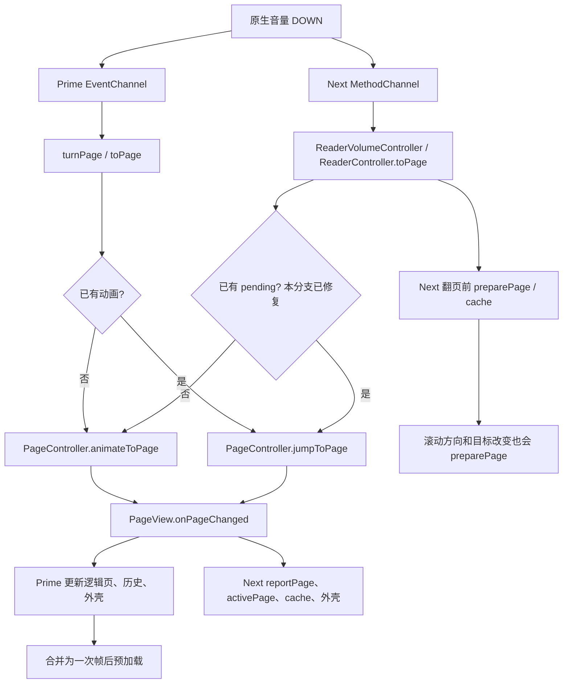

# Prime 与 Next 分页执行路径核对

## 比较对象

- Prime：只读 Git 导出 `2e287566c6fad11b0085bbdf4a528e507021ec61`，锁定 PhotoView `a1255d1b5945aad4b7323303ec2ecdf0c90ffc4c`。用户提供的 legacy-reader-benchmark `ac52a2f38e7b27dede8ab4702c07d3525fc68c21` 的父提交正是该基线；没有换用其他 Prime 渲染实现。
- Next 对照：本分支 `6fc5009489be912893d538567b856b8282fdea8d`；导航范围实验以它为基底，准确未提交补丁／APK 散列见本地 `raw/next-navigation-release-source.json`。
- 官方新测试源码 `9b9a7939f7a1b97db57e8687ece9e508b5057fcb` 单独核对。它不能代替发布 RC.3，也不能代替优化完成的 Prime 作为验收目标。用户外部记录标注版本 RC.3+252，但不能仅凭版本字段验证二进制 SHA。

两版均为真实普通 Flutter Release 引擎、相同 SDK、同一 120 Hz 设备、相同生成图片，动画均为 200 ms / ease。

## 实际路径

Prime 的 PhotoViewGallery 内部也是 PageView.builder。并无专门快速动画、停留计时器或不同动画引擎。动画中下一次命令跳页，整数页位置自然保持到下一输入。校准长按的控制器整数对齐段中位数 Prime 63.264 ms，Next 修改前 64.699 ms、视口通知修复后 65.622 ms；这些是控制器观察，不是屏幕呈现测量，不能解释或否认用户实际看到的错位。

| 入口 | Prime | Next 6fc50094 | 导航范围实验 |
|---|---|---|---|
| 分页 builder 内预加载 | 无；祖先 2f55f73 已移除 | 无 | 无 |
| 选页后预加载 | 合并到帧后，最终逻辑页 | 直接 cache(page) | 相同 |
| 翻页／滚动前准备 | 不走 Next 的 preparePage 链 | animate/jump 前及滚动目标变化 | 相同 |
| onPageChanged 重建 Gallery | 无直接 setState | 已用 activePage 通知，无直接 setState | 相同 |
| 同章节按键状态通知 | 旧 Reader 自身更新 | 整个 Reader 内容重新 build，Gallery.didUpdateWidget 再 cache | 保留内容，只更新外壳与有效性 |
| 活动页照片控制器 | 清除其他页的映射 | 激活时 reset，含手势所有权清理 | 未改，不能靠删除 reset 掩盖问题 |

官方 9b9a7939 确有 builder 内 cache(index) 与选页 Gallery.setState；这不是本分支当前执行路径。Next vendored PhotoView 相对 Prime 锁定依赖也有生命周期／手势更改，不能仅凭组件名称或整文件替换判断根因。

## 真机观测与限制

100 次约 50 ms 的离散完整 DOWN/UP、50 次实际选页、全部图片命中：

| 次数 | Prime | Next 对照 | 导航实验 |
|---|---:|---:|---:|
| Reader/Gallery build | 未以同名钩子测量 | 100 / 100 | 0 / 0 |
| cache 入口 | 50 | 250 | 100 |
| cacheReplace | 旧实现没有同名任务替换 | 200 | 100 |
| animate / jump | 50 / 50 | 50 / 50 | 50 / 50 |
| 图片 sourceLoad / imageMiss | 0 / 0 | 0 / 0 | 0 / 0 |

减少入口次数没有被当作解码次数或流畅度证据。两轮 Release UI P95 对照 4.991 / 4.614 ms，实验 4.560 / 4.008 ms，Prime 4.325 / 4.003 ms；CPU time 对照 2339 / 2153 ms，实验 2367 / 2108 ms，Prime 2222 / 2052 ms。缓存驻留均为五张／120 MiB，上限 192 MiB。保留导航范围修改，但没有宣称整体 CPU 稳定下降或长按最终验收。

r1 主线程主要在 1.8816 GHz 大核运行，r2 约 2.1–2.2 GHz，跨轮不能混比。实验 r1 有一帧 10.447 ms：Perfetto 对齐后 Running 6.827 ms、Runnable .828 ms、睡眠 2.792 ms；尚不能仅凭这些状态归因 GC 或某个 Dart 函数。完整统计见 `results/navigation-scope.json`，原始 Perfetto 留本地。

每页收藏查询是另一条执行路径。隐藏工具栏完成通知修复本身没有取消查询；随后已在
`509fc5a1` 独立加入章节状态缓存，并用 1,000 条生成收藏验证：50 次状态请求保留，
窗口内重复 SQL／整部漫画解析 50→0，CPU time 约下降 5%，详见 report.md 第五轮。
这项证据不能证明收藏查询独自造成官方新测试版此前的 12 ms UI P95。

最终产品仍保留 Next 的目标页提前准备策略。随后确实做了两轮独立实验：A 只合并帧后
调度，B 再改为已接受选页后准备窗口；均已真机复测并撤回，详见 report.md 第八轮。
当前单方向校准正向长按两版实际 sourceLoad／imageMiss 均为 76（反向 77），Next cache 入口 154、Prime 77；
入口次数多不等于两倍解码。两轮 CPU 已大致接近，没有据此直接搬换 Prime 的调度或
删除 PhotoView 活动页 reset。A 没有减少实际窗口重排，B 虽减半重排，却在两轮正向
长按增加约 5–7% CPU、多产约四分之一帧；均未满足资源要求，没有进入生产执行路径。
